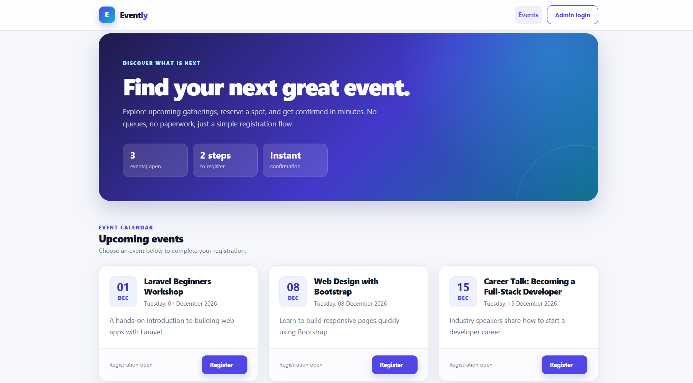

# Event Registration Management System

A Laravel-based web application for publishing events, accepting attendee registrations, and managing events and registrations through an admin dashboard.

## Screenshots

### 1. Homepage


### 2. Event Registration Form


### 3. Registration Confirmation


### 4. Admin Login


### 5. Admin Dashboard


### 6. Event Management


### 7. Registration Management


## Features

- Public listing of upcoming events.
- Event registration using name and email.
- Duplicate registration prevention per event.
- Registration confirmation page.
- Admin authentication with role-based access control.
- Admin dashboard with basic statistics.
- Create, edit and delete events.
- View and filter attendee registrations.

## Technologies Used

| Technology | Purpose |
|---|---|
| PHP 8.2+ | Backend programming |
| Laravel | Backend framework |
| MySQL / SQLite | Database |
| HTML, CSS, JavaScript | Frontend |
| Bootstrap | UI styling |
| Blade | Template engine |
| Composer | PHP dependency management |

## Prerequisites

Check whether PHP and Composer are installed before starting. The UI uses Bootstrap from a CDN and `public/css/app.css`, so Node.js and npm are not required for normal setup.

| Software | Requirement |
|---|---|
| PHP | 8.2 or newer with `pdo_sqlite` enabled |
| Composer | Version 2 |
| Git | Recommended, or download the project as a ZIP |

If PHP or Composer is missing:

- Windows: install PHP from `https://windows.php.net/download/` and Composer from `https://getcomposer.org/Composer-Setup.exe`.
- macOS: run `brew install php composer` if Homebrew is installed.
- Ubuntu/Debian: run `sudo apt install php-cli php-mbstring php-xml php-curl php-sqlite3 php-zip unzip curl`, then follow `https://getcomposer.org/download/`.

Close and reopen the terminal after installing.

Verify installations:

```bash
php -v
composer --version
```

## Installation and Setup

### 1. Clone the Repository

```bash
git clone <repository-url>
cd <project-folder>
```

### 2. Install Dependencies

```bash
composer install
```

### 3. Configure Environment

Create the `.env` file from `.env.example`.

**Windows:**

```powershell
Copy-Item .env.example .env
```

**macOS / Linux:**

```bash
cp .env.example .env
```

Generate the application key:

```bash
php artisan key:generate
```

### 4. Database Configuration

SQLite is the default database and is already set in `.env.example`:

```env
DB_CONNECTION=sqlite
```

Create the SQLite database file if it does not exist.

**Windows:**

```powershell
New-Item -ItemType File -Path "database\database.sqlite" -Force
```

**macOS / Linux:**

```bash
touch database/database.sqlite
```

To use MySQL instead, create a database:

```sql
CREATE DATABASE event_registration;
```

Then update `.env`:

```env
DB_CONNECTION=mysql
DB_HOST=127.0.0.1
DB_PORT=3306
DB_DATABASE=event_registration
DB_USERNAME=root
DB_PASSWORD=
```

### 5. Run Migrations and Seeders

```bash
php artisan migrate --seed
```

This runs the event, admin, and test user seeders. To reset local sample data later, use `php artisan migrate:fresh --seed`; this deletes existing data.

### 6. Start the Application

```bash
php artisan serve
```

Open the application:

**http://127.0.0.1:8000**

## Admin Access

| Detail | Value |
|---|---|
| Login URL | `http://127.0.0.1:8000/admin/login` |
| Email | `admin@example.com` |
| Password | `Admin@12345` |

These are local development credentials. Change the password before production use.

## Application Routes

| Route | Description |
|---|---|
| `/` | Public event listing |
| `/events/{event}/register` | Event registration form |
| `/registrations/{registration}/success` | Registration confirmation |
| `/admin/login` | Admin login |
| `/admin/dashboard` | Admin dashboard |
| `/admin/events` | Event management |
| `/admin/registrations` | Registration management |

## Database Structure

| Table | Description |
|---|---|
| `users` | Stores user and admin account details |
| `events` | Stores event information |
| `registrations` | Stores attendee registration details |

**Database relationship:** One event can have multiple registrations. Each registration belongs to one event through the `event_id` foreign key.

## Laravel Concepts Used

- MVC Architecture
- Routing and Controllers
- Blade Templates
- Eloquent ORM
- Database Migrations and Seeders
- Model Relationships
- Form Validation
- Authentication and Sessions
- Middleware
- CSRF Protection

## Troubleshooting

| Issue | Solution |
|---|---|
| PHP or Composer not recognized | Check installation and system PATH. |
| Missing `vendor` folder | Run `composer install`. |
| Application key error | Run `php artisan key:generate`. |
| Database connection error | For SQLite, check that `database/database.sqlite` exists; for MySQL, check the service and `.env` credentials. |
| Missing database tables | Run `php artisan migrate`. |
| Admin login fails | Verify admin credentials and `is_admin` value. |
| Application errors | Check `storage/logs/laravel.log`. |

## Useful Commands

```bash
# Check Laravel version
php artisan --version

# View registered routes
php artisan route:list

# Check migration status
php artisan migrate:status

# Run tests
php artisan test

# Clear application caches
php artisan optimize:clear
```